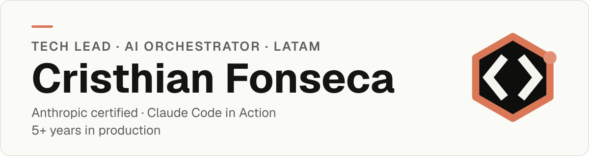
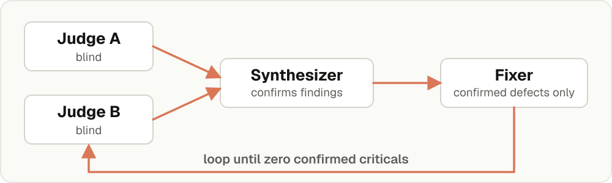

<picture>
  <source media="(prefers-color-scheme: dark)" srcset="assets/banner-dark.svg">
  <source media="(prefers-color-scheme: light)" srcset="assets/banner-light.svg">
  
</picture>

**I build AI systems that run in production.**

I start with who it hurts and what it costs. The code comes last.

**[See what I've built →](https://crisfon6.com/projects)** · [Get the latest AI blueprint](https://crisfon6.com/newsletter)

 

## Receipts

<table>
  <tr>
    <td align="center" width="33%"><h3>−43%</h3>AWS spend after a cost audit ~$16.8K a year · $3,259 → $1,860 a month (sum of removed line items)</td>
    <td align="center" width="33%"><h3>21 s</h3>to export 638K rows down from ~28 min</td>
    <td align="center" width="33%"><h3>17 s</h3>production rollback exercised in prod</td>
  </tr>
</table>

## What I'm building

<table>
  <tr>
    <td valign="top" width="50%">
      <h3>Prosperas</h3>
      <b>~100K monthly active users</b> in a 45M-user ecosystem. 
      Technical Lead on a digital credit marketplace inside a telecom super app. AWS, fully codified with CDK.
    </td>
    <td valign="top" width="50%">
      <h3>Aphrodite (private)</h3>
      <b>Solo founder and tech lead.</b> 
      AI companion marketplace that fights loneliness with an AI that actually knows each user. Built with a multi-agent engineering org I designed.
    </td>
  </tr>
</table>

## How I work: an engineering org made of agents

<picture>
  <source media="(prefers-color-scheme: dark)" srcset="assets/pipeline-dark.svg">
  <source media="(prefers-color-scheme: light)" srcset="assets/pipeline-light.svg">
  
</picture>
 
Extended from the <a href="https://github.com/Gentleman-Programming/gentle-ai/blob/main/internal/assets/skills/judgment-day/SKILL.md">judgment-day</a> pattern by Gentleman Programming, for unattended loops.

<table>
  <tr>
    <td valign="top" width="50%">
      <b>Autonomous backlog runner</b> 
      Pulls issues from Linear and works them in isolated workspaces. First full run: <b>13 issues → 11 merged PRs in one day.</b>
    </td>
    <td valign="top" width="50%">
      <b>MCP over production data</b> 
      An MCP server that lets the business query real data. I traced a <b>98.4% undercount</b> and fixed it.
    </td>
  </tr>
</table>

## Open source

- **Code:** [ai-org-agents](https://github.com/Crisfon6-dev/ai-org-agents) — config-driven multi-agent AI team (Founder, CTO, Marketer, PO, Coder) with shared memory and adaptive model routing.
- **Code:** [crisfon6-website](https://github.com/Crisfon6-dev/crisfon6-website) — my portfolio: verifiable production numbers, bilingual EN/ES. Next.js 16 + Tailwind v4.

## Stack

**AI** — Claude API · Claude Code · MCP · multi-agent orchestration · pgvector/RAG 
**Cloud** — AWS (CDK, Lambda, RDS, ElastiCache, Cognito, S3) · Docker · CI/CD 
**Code** — Python/FastAPI · TypeScript/Next.js · Angular · Java/Spring Boot · PostgreSQL

---

Technology serves the business. LATAM talent, global problems.

